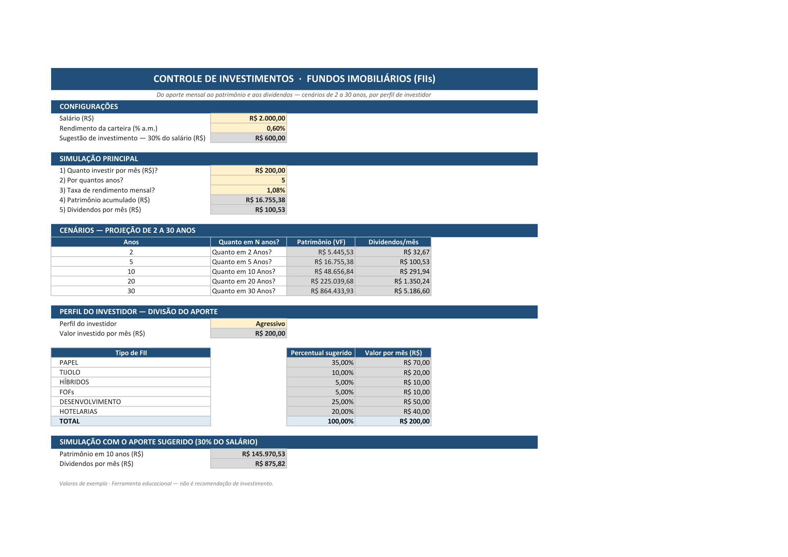
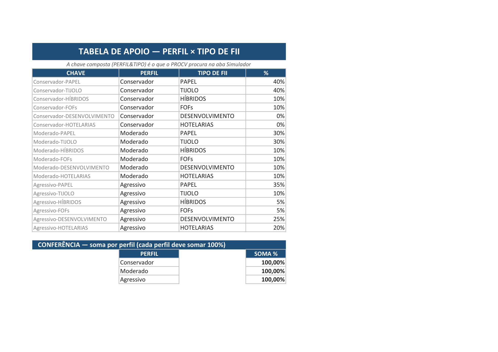

# 📊 Ferramenta de Controle de Investimentos — Fundos Imobiliários (FIIs)

[](https://www.dio.me)
[](https://www.microsoft.com/pt-br/microsoft-365/excel)
[](https://github.com/everferreira)

> ⬇️ **Baixar a planilha**: [`controle-investimentos.xlsx`](controle-investimentos.xlsx)

Desafio de Projeto da **Formação Análise de Dados com Excel e IA** (DIO, Expert [Felipe Aguiar](https://github.com/felipeAguiarCode)): construir, do zero e em uma planilha em branco, uma ferramenta que simula investimentos em **fundos imobiliários** — do aporte mensal ao patrimônio acumulado e aos dividendos — com projeções de 2 a 30 anos e divisão do aporte por **perfil de investidor**.

A planilha é uma ferramenta de uso simples (não exige saber fórmula): o usuário digita **salário, aporte, prazo e taxa** e escolhe o **perfil** numa lista — todo o resto é calculado automaticamente.

---

## 🧭 As 5 perguntas que a ferramenta responde

| Pergunta | Onde aparece a resposta |
|---|---|
| 1. Quanto investir por mês? | Aba **Simulador** → *Simulação Principal* → célula **B9** (entrada `aporte`) |
| 2. Por quantos anos? | **B10** (entrada `qtd_anos`) |
| 3. Qual a taxa de rendimento mensal? | **B11** (entrada `taxa_mensal`) |
| 4. Quanto de patrimônio vai acumular? | **B12** — `=VF(taxa_mensal;qtd_anos*12;-aporte)` |
| 5. Quanto vai receber de dividendos por mês? | **B13** — `=patrimonio*rendimento_carteira` |

Além das 5 respostas, a ferramenta projeta o patrimônio em **cenários de 2, 5, 10, 20 e 30 anos** e divide o aporte entre **6 tipos de FII** conforme o perfil escolhido (Conservador, Moderado ou Agressivo), sempre somando **100%**.

### ✅ Resultados verificados (Excel recalculou de verdade)

Simulação de exemplo: salário R$ 2.000, aporte R$ 200/mês, 5 anos, taxa de 1,079% a.m., rendimento da carteira 0,6% a.m.:

| Cenário | Patrimônio acumulado (VF) | Dividendos/mês |
|---:|---:|---:|
| 2 anos | R$ 5.445,53 | R$ 32,67 |
| 5 anos | R$ 16.755,38 | R$ 100,53 |
| 10 anos | R$ 48.656,84 | R$ 291,94 |
| 20 anos | R$ 225.039,68 | R$ 1.350,24 |
| 30 anos | R$ 864.433,93 | R$ 5.186,60 |

*(valores lidos da planilha já calculada pelo Excel — arquivo salvo com o perfil Moderado)*

---

## 🧮 Como o VF entra nos cálculos

A função **VF** (`FV`, do inglês *Future Value*) calcula o valor futuro de uma série de pagamentos periódicos com juros compostos:

```
VF(taxa; nper; pgto; [va]; [tipo])
```

- `taxa` → `taxa_mensal` (rendimento mensal do investimento)
- `nper` → `qtd_anos * 12` (converte anos em número de períodos mensais)
- `pgto` → `-aporte` (negativo = saída de caixa, conforme a convenção de sinal do Excel)

Exemplos na planilha:

- **Patrimônio acumulado** (B12): `=VF(taxa_mensal;qtd_anos*12;-aporte)`
- **Cenários** (linhas 17–21): `=VF($B$11;A17*12;-$B$9)` — com **referências absolutas** (`$`), a fórmula pode ser arrastada sem se perder
- **Simulação com o aporte sugerido** (B37): `=VF(taxa_mensal;10*12;-sugestao_investimento)` — usa direto os 30% do salário

**Dividendos** = patrimônio × rendimento da carteira: `=patrimonio*rendimento_carteira` (B13) e `=C17*$B$5` nos cenários.

## 🔑 Como o PROCV acha o percentual de cada perfil

O PROCV (**VLOOKUP**) procura um valor numa tabela e devolve o conteúdo de outra coluna da mesma linha:

```
PROCV(valor_procurado; tabela; coluna; [correspondência_exata])
```

O truque do desafio é a **chave composta**: o percentual depende de *duas* informações (perfil + tipo de fundo), então as duas são concatenadas em uma chave única.

1. Na aba **Perfis** (tabela de apoio), a coluna `CHAVE` é montada com `=PERFIL&"-"&TIPO` — ex.: `Moderado-TIJOLO` → 30%, `Agressivo-HOTELARIAS` → 20%.
2. Na aba **Simulador**, cada linha de tipo de fundo faz:

```
=PROCV($B$24&"-"&A28;tabela_perfis;4;FALSO)
```

- `$B$24&"-"&A28` → monta a mesma chave com o perfil escolhido na lista + o tipo da linha
- `tabela_perfis` → intervalo nomeado da tabela de apoio
- `4` → coluna `%` (a 4ª coluna da tabela)
- `FALSO` → busca **exata** (senão o 2º parâmetro procuraria aproximações)

Trocar o perfil na lista propaga a nova divisão instantaneamente — e o `TOTAL` (linha 34) prova que o aporte foi 100% dividido.

## 🏷️ Intervalos nomeados criados

| Nome | Célula/intervalo | Uso |
|---|---|---|
| `salario` | Simulador!$B$4 | entrada do salário |
| `rendimento_carteira` | Simulador!$B$5 | rendimento p/ calcular dividendos |
| `sugestao_investimento` | Simulador!$B$6 | `=salario*30%` → aporte sugerido |
| `aporte` | Simulador!$B$9 | quanto investir por mês |
| `qtd_anos` | Simulador!$B$10 | prazo em anos |
| `taxa_mensal` | Simulador!$B$11 | taxa de rendimento mensal |
| `patrimonio` | Simulador!$B$12 | patrimônio acumulado (VF) |
| `tabela_perfis` | Perfis!$A$4:$D$21 | tabela de apoio do PROCV |

Intervalos nomeados deixam as fórmulas **legíveis** (`=VF(taxa_mensal;qtd_anos*12;-aporte)` em vez de `=VF($B$11;$B$10*12;-$B$9)`) e os endereços passam a ter significado de negócio.

## 🎯 Percentuais de cada perfil — e de onde vieram

| Tipo de FII | Conservador | Moderado | Agressivo |
|---|---:|---:|---:|
| PAPEL (papéis, renda estável) | 40% | 30% | 35% |
| TIJOLO (lajes e logística) | 40% | 30% | 10% |
| HÍBRIDOS (renda + ganho de capital) | 10% | 10% | 5% |
| FOFs (fundos de fundos, diversificação) | 10% | 10% | 5% |
| DESENVOLVIMENTO (ciclo imobiliário, maior risco) | 0% | 10% | 25% |
| HOTELARIAS (setor cíclico) | 0% | 10% | 20% |
| **Total** | **100%** | **100%** | **100%** |

Os percentuais são **exemplo educacional, não recomendação de investimento**. A lógica: o perfil **Conservador** concentra em ativos de renda previsível (PAPEL + TIJOLO = 80%); o **Moderado** equilibra renda e crescimento; o **Agressivo** reduz TIJOLO e aumenta DESENVOLVIMENTO e HOTELARIAS (classes com maior potencial de valorização e maior risco). Cada perfil soma exatamente 100% — conferência automática na aba Perfis com `SOMASES` por perfil (1% → 100%).

## 🖼️ Prints da ferramenta (mesma simulação, dois perfis)

**Perfil Conservador** — PAPEL R$ 80 · TIJOLO R$ 80 · HÍBRIDOS R$ 20 · FOFs R$ 20 (total R$ 200):


**Perfil Agressivo** — PAPEL R$ 70 · TIJOLO R$ 20 · HÍBRIDOS R$ 10 · FOFs R$ 10 · DESENVOLVIMENTO R$ 50 · HOTELARIAS R$ 40 (total R$ 200):



**Tabela de apoio (aba Perfis)** — chave composta + conferência de 100% por perfil:



> Os prints foram exportados do próprio Excel (aba → exportar como PDF → imagem), com linhas de grade ocultas — a planilha tem cara de aplicativo.

## ✏️ O que mudei em relação à ferramenta do Expert

- **Banner e identidade visual**: banner próprio, seções coloridas, células calculadas em cinza (não editáveis) e células de entrada destacadas em amarelo.
- **Cenários com intervalos nomeados**: mantive as referências absolutas no `$B$11`/`$B$9` (como pede o passo 3), mas as fórmulas principais usam intervalos nomeados.
- **Simulação extra com o aporte sugerido**: além da principal, uma segunda simulação que investe os **30% do salário** (`sugestao_investimento`) e projeta patrimônio e dividendos em 10 anos — uma das evoluções sugeridas no desafio.
- **Conferência automática na aba de apoio**: bloco `SOMASES` por perfil provando que cada um soma 100%.
- **Percentuais próprios**: valores de exemplo diferentes dos do Expert, com a lógica por perfil explicada acima (ambos somam 100%).
- **Nota de rodapé** lembrando que os valores são educacionais, não recomendação de investimento.

## 🛠️ Como foi feito

- **Planilha**: construída célula a célula com **Python + openpyxl** (script [`build_planilha.py`](build_planilha.py)) — baner, formulários, fórmulas VF/PROCV, validação de dados da lista de perfis, intervalos nomeados e formatação.
- **Verificação**: a planilha foi aberta e recalculada no **Excel real** (via COM), os valores foram lidos daí e os prints exportados do próprio Excel — nada de screenshot editado.
- **Imagens**: exportação PDF do Excel → PNG (alta resolução).

### Estrutura do repositório

```
controle-investimentos-excel/
├── controle-investimentos.xlsx   # a ferramenta pronta
├── build_planilha.py             # script que gera a planilha do zero
├── export_prints.ps1             # script de exportação dos prints (Excel COM)
├── prints/
│   ├── print_conservador.png     # simulação com perfil Conservador
│   ├── print_agressivo.png       # simulação com perfil Agressivo
│   └── print_perfis.png          # tabela de apoio (aba Perfis)
└── README.md
```

> ⚠️ **Atenção**: o salário (R$ 2.000) e todos os valores da planilha publicada são **exemplo** — não são dados pessoais nem recomendação de investimento.

---

<div align="center">

**Autora:** [Ever Ferreira](https://github.com/everferreira) · [LinkedIn](https://linkedin.com/in/evermaria)

Desafio da [Formação Análise de Dados com Excel e IA](https://www.dio.me) — DIO · Expert: Felipe Aguiar

⌨️ com 💜 por Ever Ferreira

</div>